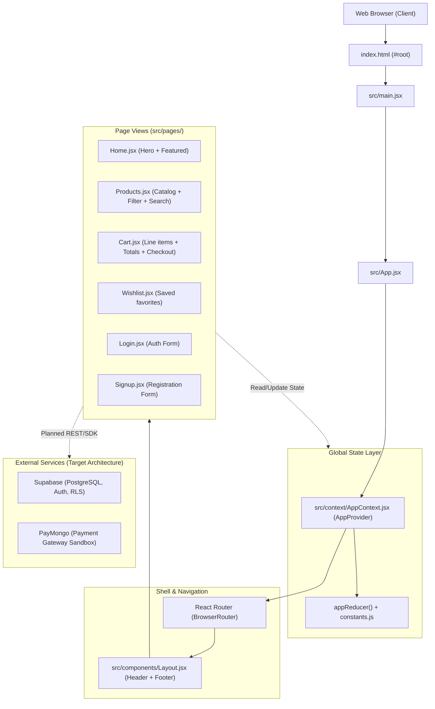

# Zion E-Commerce System Architecture

This document provides a comprehensive overview of the application's structural design, component hierarchy, routing system, and directory conventions for both human engineers and AI agents.

---

## 1. High-Level Architecture Overview

Zion E-Commerce is a modern Single Page Application (SPA) built with **React 19**, **Vite 7**, **Tailwind CSS v3**, and **Framer Motion 11**. Global client state is centralized using React's **Context API & useReducer**, while backend database persistence and authentication are designed for **Supabase (PostgreSQL + Auth)**, and payments for **PayMongo (Test Sandbox)**.



---

## 2. Directory Structure & Conventions

```
zion-shop/
├── public/                  # Static assets served untouched (e.g., vite.svg)
├── src/
│   ├── assets/              # Bundled image and SVG assets
│   ├── components/          # Reusable shared UI components
│   │   ├── Layout.jsx       # Global application shell (Header, Nav, Footer)
│   │   └── LandingPage.jsx  # Original monolithic landing page (reference/legacy)
│   ├── context/             # Global client state management
│   │   ├── AppContext.jsx   # AppProvider, useApp hook, and appReducer
│   │   └── constants.js     # Action type strings and initialState definition
│   ├── pages/               # Route-level page components
│   │   ├── Home.jsx         # Hero showcase and featured products
│   │   ├── Products.jsx     # Filterable and searchable product catalog
│   │   ├── Cart.jsx         # Cart items listing, quantities, price summary
│   │   ├── Wishlist.jsx     # User saved items management
│   │   ├── Login.jsx        # Login form and OAuth placeholder
│   │   └── Signup.jsx       # User registration form
│   ├── App.css              # Custom font declarations & helper utilities
│   ├── App.jsx              # Application router and provider wrapper
│   ├── index.css            # Tailwind directives and base layer styles
│   └── main.jsx             # React 19 DOM root mounting
├── docs/                    # Technical & architectural documentation
├── eslint.config.js         # ESLint 9 Flat Config
├── package.json             # Project dependencies and npm scripts
├── postcss.config.cjs       # PostCSS plugins (TailwindCSS, Autoprefixer)
├── tailwind.config.cjs      # Tailwind CSS design system tokens and theme
└── vite.config.js           # Vite build configuration with React plugin
```

---

## 3. Application Lifecycle & Routing Flow

1. **Mounting**:
   - [index.html](file:///c:/Users/windows11/Documents/GitHub/zion-shop/index.html) loads `/src/main.jsx` inside `<div id="root"></div>`.
   - [main.jsx](file:///c:/Users/windows11/Documents/GitHub/zion-shop/src/main.jsx) calls `createRoot` and renders `<App />` in `<StrictMode>`.
2. **State & Shell Wrappers**:
   - [App.jsx](file:///c:/Users/windows11/Documents/GitHub/zion-shop/src/App.jsx) encapsulates `<Router>` within `<AppProvider>` so all nested components and layouts have access to cart and wishlist state.
   - `<Layout>` wraps `<Routes>` to render a sticky animated top header (with badges for wishlist and cart item counts) and the shared footer.
3. **Route Table**:

| Route Path | Component | Description |
|---|---|---|
| `/` | [Home](file:///c:/Users/windows11/Documents/GitHub/zion-shop/src/pages/Home.jsx) | Hero banner, value propositions, and featured mock items |
| `/products` | [Products](file:///c:/Users/windows11/Documents/GitHub/zion-shop/src/pages/Products.jsx) | Full product grid, category tabs, text search, price sort |
| `/cart` | [Cart](file:///c:/Users/windows11/Documents/GitHub/zion-shop/src/pages/Cart.jsx) | Line items list, increment/decrement controls, total breakdown |
| `/wishlist` | [Wishlist](file:///c:/Users/windows11/Documents/GitHub/zion-shop/src/pages/Wishlist.jsx) | Saved items, remove action, one-click "Move to Cart" |
| `/login` | [Login](file:///c:/Users/windows11/Documents/GitHub/zion-shop/src/pages/Login.jsx) | Authentication credentials form, Google OAuth trigger |
| `/signup` | [Signup](file:///c:/Users/windows11/Documents/GitHub/zion-shop/src/pages/Signup.jsx) | Registration form with name, email, password validation |

---

## 4. Key Module Relationships & God Nodes

From the Graphify structural analysis, the most interconnected abstractions in the project are:
- **`useApp()`** ([AppContext.jsx](file:///c:/Users/windows11/Documents/GitHub/zion-shop/src/context/AppContext.jsx)): Central hub accessed by `Layout`, `Home`, `Products`, `Cart`, and `Wishlist`.
- **`Layout`** ([Layout.jsx](file:///c:/Users/windows11/Documents/GitHub/zion-shop/src/components/Layout.jsx)): Bridges routing paths with navigation badge indicators.
- **`framer-motion`**: Omnipresent animation dependency driving staggered entrances, hover transforms, and mobile drawer transitions across all page components.
