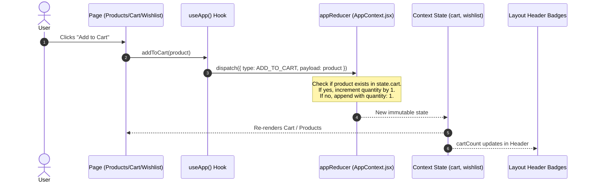

# Data Flow & State Management

This document details the state lifecycle, reducer mechanics, action specifications, and the target database schema for Zion E-Commerce.

---

## 1. Client State Architecture (`AppContext`)

Global application state is managed in [src/context/AppContext.jsx](file:///c:/Users/windows11/Documents/GitHub/zion-shop/src/context/AppContext.jsx) using React's `useReducer` and `createContext`.



---

## 2. Reducer Action Specifications

All action types are exported as constants from [src/context/constants.js](file:///c:/Users/windows11/Documents/GitHub/zion-shop/src/context/constants.js).

| Action Constant | Payload | Logic & Invariants |
|---|---|---|
| `ADD_TO_CART` | `product: Object` | If item exists, increments `item.quantity + 1`. Otherwise appends with `quantity: 1`. |
| `REMOVE_FROM_CART` | `productId: string\|number` | Filters `state.cart` removing matching `item.productId`. |
| `UPDATE_CART_QUANTITY` | `{ productId, quantity }` | Updates quantity. Filters out items with `quantity <= 0`. |
| `ADD_TO_WISHLIST` | `product: Object` | Deduplicates: if `productId` is already in wishlist, state is unchanged. |
| `REMOVE_FROM_WISHLIST` | `productId: string\|number` | Filters `state.wishlist` removing matching `item.productId`. |
| `CLEAR_CART` | `void` | Resets `state.cart` to `[]`. |
| `CLEAR_WISHLIST` | `void` | Resets `state.wishlist` to `[]`. |
| `moveToCart(product)` | `product: Object` | Convenience action: calls `addToCart(product)` then `removeFromWishlist(product.productId)`. |

### Exposed Context Value
Components accessing `useApp()` receive:
```typescript
interface AppContextValue {
  cart: CartItem[];
  wishlist: Product[];
  cartCount: number;         // Cumulative sum of item quantities
  wishlistCount: number;     // Array length of wishlist
  addToCart: (product: Product) => void;
  removeFromCart: (productId: string | number) => void;
  updateCartQuantity: (productId: string | number, quantity: number) => void;
  addToWishlist: (product: Product) => void;
  removeFromWishlist: (productId: string | number) => void;
  clearCart: () => void;
  clearWishlist: () => void;
  moveToCart: (product: Product) => void;
}
```

---

## 3. Database Schema (Supabase PostgreSQL)

When transitioning from local mock state to a persistent database, the application maps to the following Supabase schema:

```sql
-- Enable UUID generation extension
create extension if not exists "uuid-ossp";

-- 1. User Profiles (Mirrors auth.users)
create table profiles (
  id uuid primary key references auth.users on delete cascade,
  full_name text,
  avatar_url text,
  created_at timestamptz default now()
);

-- 2. Products Catalog
create table products (
  id uuid primary key default uuid_generate_v4(),
  name text not null,
  description text,
  price numeric(10,2) not null,
  original_price numeric(10,2),
  image_url text not null,
  category text not null,
  rating numeric(3,2) default 5.0,
  reviews_count int default 0,
  metadata jsonb,
  created_at timestamptz default now()
);

-- 3. Shopping Cart Line Items
create table cart_items (
  id uuid primary key default uuid_generate_v4(),
  user_id uuid references profiles(id) on delete cascade,
  product_id uuid references products(id) on delete cascade,
  quantity int default 1 check (quantity > 0),
  added_at timestamptz default now(),
  unique (user_id, product_id)
);

-- 4. Wishlist Items
create table wishlist_items (
  id uuid primary key default uuid_generate_v4(),
  user_id uuid references profiles(id) on delete cascade,
  product_id uuid references products(id) on delete cascade,
  added_at timestamptz default now(),
  unique (user_id, product_id)
);

-- 5. Orders & Transactions
create table orders (
  id uuid primary key default uuid_generate_v4(),
  user_id uuid references profiles(id) on delete cascade,
  total numeric(10,2) not null,
  status text not null default 'pending', -- 'pending', 'paid', 'failed', 'fulfilled'
  payment_reference text,
  metadata jsonb,
  created_at timestamptz default now()
);
```

---

## 4. State Migration Path: Mock to Supabase

1. **Guest Mode**: Maintain current `AppContext` in `localStorage` for unauthenticated visitors.
2. **Authenticated Sync**: When a user logs in via Supabase Auth, merge guest `cart_items` into the user's Supabase rows.
3. **Realtime**: Subscribe to Supabase Realtime channels on `cart_items` to synchronize cart count across browser tabs.
