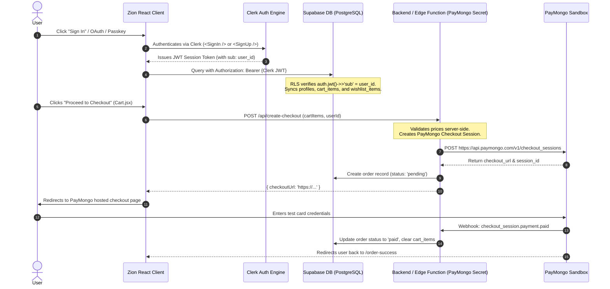

# Integrations Roadmap: Clerk Auth, Supabase & PayMongo

This guide specifies the implementation plan, security architecture, and code patterns for integrating **Clerk Authentication**, **Supabase** (PostgreSQL Database & Storage), and **PayMongo** (Test Sandbox Checkout) into Zion E-Commerce.

---

## 1. System Integration Flow



---

## 2. Clerk & Supabase Implementation Blueprint

### 2.1 Dynamic Client Factory ([src/lib/supabase.js](file:///c:/Users/windows11/Documents/GitHub/zion-shop/src/lib/supabase.js))
Because Supabase validates Clerk session tokens via Third-Party Auth, the client dynamically resolves `getToken()`:

```javascript
import { createClient } from '@supabase/supabase-js'

export const createClerkSupabaseClient = (getToken) => {
  return createClient(supabaseUrl, supabaseAnonKey, {
    auth: { persistSession: false, autoRefreshToken: false },
    global: {
      headers: async () => {
        if (!getToken) return {}
        const token = await getToken()
        return token ? { Authorization: `Bearer ${token}` } : {}
      }
    }
  })
}
```

### 2.2 Row Level Security (RLS) Rules for Clerk
In Supabase Third-Party Auth, Clerk user IDs are strings matching `auth.jwt() ->> 'sub'`:

```sql
-- Enable RLS
alter table profiles enable row level security;
alter table cart_items enable row level security;
alter table wishlist_items enable row level security;
alter table orders enable row level security;

-- Profiles: user owns profile matching Clerk ID
create policy "Public profiles are viewable by everyone" on profiles for select using (true);
create policy "Users can update own profile" on profiles for update using (auth.jwt()->>'sub' = id);
create policy "Users can insert own profile" on profiles for insert with check (auth.jwt()->>'sub' = id);

-- Cart items: owner only
create policy "Users can view own cart" on cart_items for select using (auth.jwt()->>'sub' = user_id);
create policy "Users can insert own cart" on cart_items for insert with check (auth.jwt()->>'sub' = user_id);
create policy "Users can update own cart" on cart_items for update using (auth.jwt()->>'sub' = user_id);
create policy "Users can delete own cart" on cart_items for delete using (auth.jwt()->>'sub' = user_id);

-- Wishlist: owner only
create policy "Users can view own wishlist" on wishlist_items for select using (auth.jwt()->>'sub' = user_id);
create policy "Users can manage own wishlist" on wishlist_items for all using (auth.jwt()->>'sub' = user_id);

-- Orders: owner read
create policy "Users can view own orders" on orders for select using (auth.jwt()->>'sub' = user_id);
```

---

## 3. PayMongo Test Checkout Integration

PayMongo requires a server-side environment because the secret key must never be exposed to the client bundle.

### 3.1 Server Function Strategy
The backend dependencies already present in [package.json](file:///c:/Users/windows11/Documents/GitHub/zion-shop/package.json) (`express`, `cors`, `body-parser`) can be run as a lightweight microservice or implemented via Supabase Edge Functions:

```javascript
// Example server route: POST /api/checkout
import express from 'express'
import axios from 'axios'
import cors from 'cors'

const app = express()
app.use(cors())
app.use(express.json())

const PAYMONGO_SECRET_KEY = process.env.PAYMONGO_SECRET_KEY // sk_test_...

app.post('/api/create-checkout', async (req, res) => {
  try {
    const { items, successUrl, cancelUrl } = req.body

    const lineItems = items.map(item => ({
      name: item.name,
      amount: Math.round(parseFloat(item.price.replace('$', '')) * 100), // amount in cents
      currency: 'PHP', // or USD
      quantity: item.quantity,
      images: [item.image]
    }))

    const response = await axios.post(
      'https://api.paymongo.com/v1/checkout_sessions',
      {
        data: {
          attributes: {
            line_items: lineItems,
            payment_method_types: ['card', 'gcash', 'paymaya'],
            success_url: successUrl,
            cancel_url: cancelUrl
          }
        }
      },
      {
        headers: {
          Authorization: `Basic ${Buffer.from(PAYMONGO_SECRET_KEY + ':').toString('base64')}`,
          'Content-Type': 'application/json'
        }
      }
    )

    const checkoutUrl = response.data.data.attributes.checkout_url
    res.json({ checkoutUrl })
  } catch (err) {
    res.status(500).json({ error: err.message })
  }
})
```

---

## 4. Execution Milestones

| Phase | Tasks | Key Deliverables |
|---|---|---|
| **Phase 1: Database Migration** | Create Supabase project, execute SQL schema, populate `products` table | `src/lib/supabase.js`, Supabase product fetch in [Products.jsx](file:///c:/Users/windows11/Documents/GitHub/zion-shop/src/pages/Products.jsx) |
| **Phase 2: Auth Synchronization** | Connect Login/Signup forms, enable Google OAuth | Persistent user sessions, profile drawer |
| **Phase 3: Persistent Cart/Wishlist** | Sync `AppContext` with `cart_items` and `wishlist_items` tables | Cross-device cart continuity |
| **Phase 4: PayMongo Sandbox** | Implement backend checkout endpoint, webhook listener | Simulated end-to-end purchasing |
